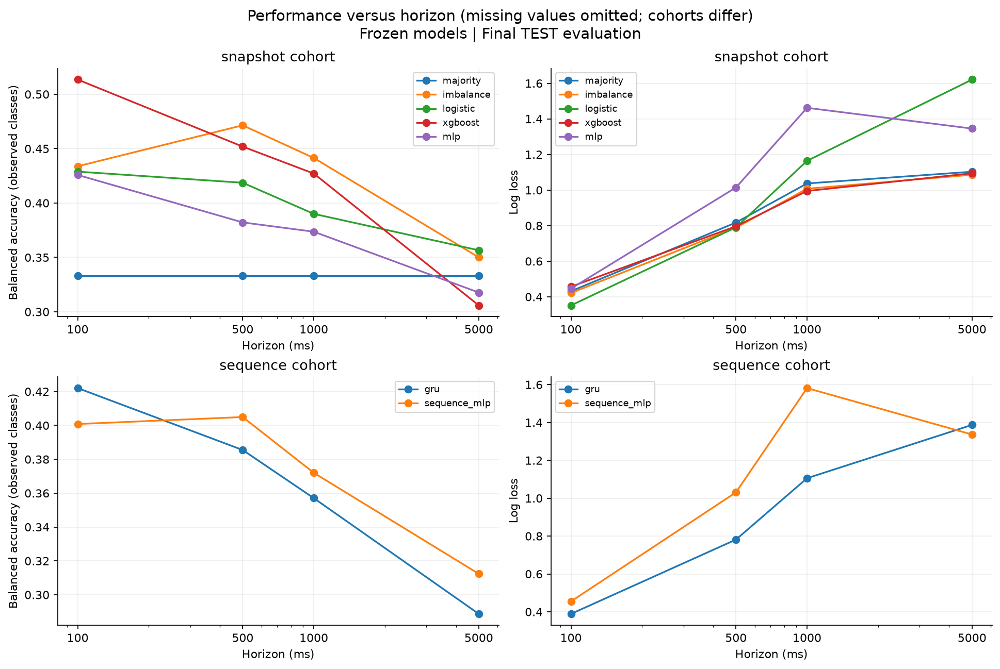

# Limit Order Book Price Prediction

A Python research project on short-horizon BTC-USD mid-price prediction using
Coinbase order-book updates and trades.

I compare simple baselines with tree and neural models to study whether book
imbalance, order flow, and trades help predict price direction, and how that changes
with the prediction horizon.

## What is implemented

- Coinbase recorder with reconnects, file rotation, and raw message storage.
- L2 reconstruction with decimal prices, atomic updates, and snapshot recovery;
  100 ms sampling and 99 microstructure features.
- Three-class price-direction and return targets at 100 ms, 500 ms, 1 s, and 5 s.
- Majority, imbalance, logistic regression, XGBoost, MLP, and GRU classifiers;
  zero-return, ridge, and XGBoost regressors.
- Chronological evaluation with TRAIN-only preprocessing, feature ablations,
  calibration, regime analysis, and a frozen-model final TEST workflow.

## Start here

Python 3.11 or later is required; the test suite was run on Python 3.13.

~~~bash
python -m venv .venv
~~~

Activate the environment with **.venv\Scripts\Activate.ps1** on PowerShell or
**source .venv/bin/activate** on macOS/Linux, then:

~~~bash
python -m pip install -e ".[dev]"
python scripts/book_demo.py
python -m pytest -q
python -m ruff check .
python -m ruff format --check .
~~~

The book demo and 420 tests run offline using synthetic fixtures.

For a full collection-to-evaluation example, see [Running experiments](docs/usage.md).

## Design

~~~text
WebSocket -> raw JSONL -> L2 reconstruction -> 100 ms observations
                                              |
                                     features + future labels
                                              |
                                   chronological split + purge
                                              |
                              TRAIN fit -> validation comparisons
~~~

The source adapter converts exchange messages into normalized events. Other feeds
can use the same book and research code. Collection runs separately from training.

| Directory | Purpose |
| --- | --- |
| src/market_microstructure/book | Book state and atomic updates |
| src/market_microstructure/data | Coinbase adapter, recorder, and raw storage |
| src/market_microstructure/processing | Sampling, features, labels, splits, and preprocessing |
| src/market_microstructure/models | Baselines, neural models, and saved-run handling |
| src/market_microstructure/evaluation | Metrics, comparisons, and plots |
| scripts | Command-line entry points |
| configs | Experiment and processing settings |
| tests | Reconstruction, causality, alignment, model, and corruption checks |
| docs | Methods, usage, and experiment results |

See [Methods](docs/methods.md) for label definitions, leakage controls, model settings,
and evaluation conventions. [Final evaluation](docs/final_evaluation.md) describes
regression and the separate frozen-model TEST workflow.

## Same-day experiment

Six three-minute BTC-USD sessions, separated by one-minute gaps, produced 23,608
messages and 10,756 sampled observations. Sessions 1-4 were assigned to TRAIN,
session 5 to validation, and session 6 to TEST before collection. Recording took
place on October 22, 2026 in Chicago time (October 23 UTC).

The frozen grid completed 36 classification and 12 regression runs. At 500 ms,
the snapshot models use the same 1,788 final TEST targets:

| Model | TEST accuracy | Balanced accuracy | Log loss |
| --- | ---: | ---: | ---: |
| Majority | 0.7092 | 0.3333 | 0.8176 |
| Imbalance sign | 0.2092 | 0.4715 | 0.7886 |
| Logistic regression | 0.7355 | 0.4186 | 0.7904 |
| XGBoost | 0.6924 | 0.4519 | 0.7964 |
| MLP | 0.7232 | 0.3822 | 1.0145 |

Neural models and larger feature sets show no consistent advantage. Learned
regressors slightly improve RMSE at short horizons but lose to zero return at 5 s.

See [Results](docs/results.md) for the analysis and limitations, and the
[numerical record](docs/experiment.json) for metrics and hashes. TEST covers one
three-minute interval, so the findings need checking across other market periods.

## Repository scope

This repository contains the implementation, tests, configurations, and selected
results. Raw captures, processed datasets, checkpoints, virtual environments, and
run archives are omitted. New data and results are ignored by Git.

The project evaluates predictions; it does not submit orders or model fills.
Python inference timings exclude network and exchange latency. Public crypto spot
data also limits how directly the results transfer to futures or options markets.
