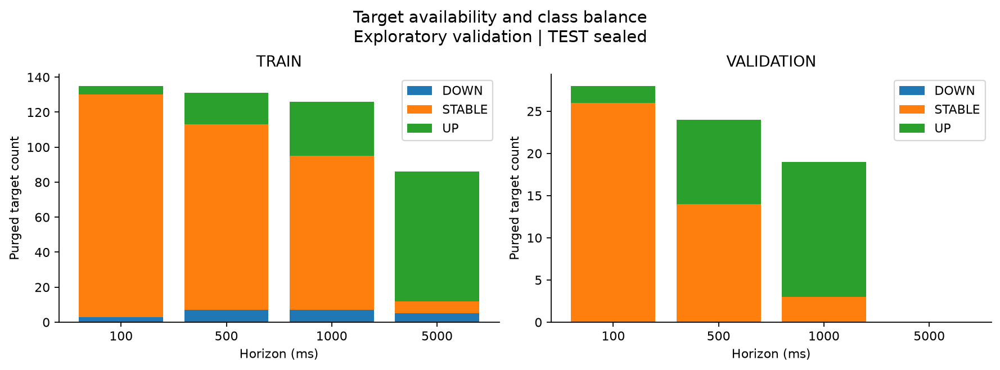
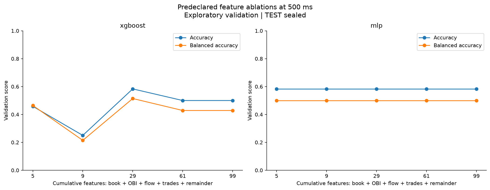
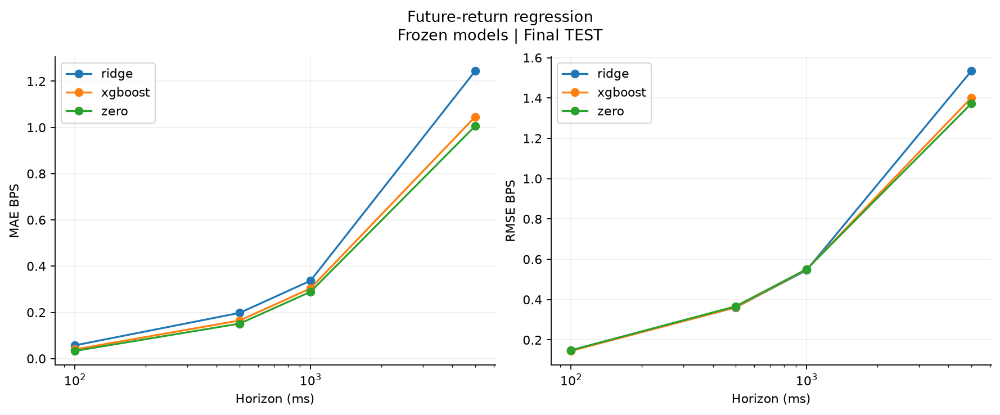

# Same-day research results

Six BTC-USD sessions were recorded on October 22, 2026 in Chicago time (October 23
UTC): three minutes each, separated by one-minute gaps. The 18 recorded minutes
contain 23,608 messages and 10,756 sampled observations.

Sessions were assigned before collection: four TRAIN, one validation, one TEST,
with 7,170 / 1,793 / 1,793 feature rows. Targets require a future observation in the
same segment, so counts fall with horizon. The class threshold was fixed at one tick.

Neural training used up to 40 epochs, patience 8, batch size 128, and seed 42.
Validation selected checkpoints; all 36 classification and 12 regression runs were
frozen before final TEST evaluation. The [classification configuration](../configs/experiments/completion.yaml),
[regression settings](../configs/regression.yaml), and
[numerical record](experiment.json) accompany the tables.

## Classification across horizons

Cells show final TEST balanced accuracy. All three classes are present at every
horizon, so these average DOWN, STABLE, and UP recall equally.

| Model | 100 ms | 500 ms | 1 second | 5 seconds |
| --- | ---: | ---: | ---: | ---: |
| Majority | 0.3333 | 0.3333 | 0.3333 | 0.3333 |
| Imbalance sign | 0.4338 | 0.4715 | 0.4414 | 0.3501 |
| Logistic regression | 0.4289 | 0.4186 | 0.3901 | 0.3566 |
| XGBoost | 0.5135 | 0.4519 | 0.4271 | 0.3059 |
| MLP | 0.4258 | 0.3822 | 0.3736 | 0.3177 |
| GRU | 0.4220 | 0.3855 | 0.3571 | 0.2887 |
| Matched MLP | 0.4008 | 0.4049 | 0.3720 | 0.3124 |

Snapshot target counts are 1,792 / 1,788 / 1,783 / 1,743. GRU and its matched MLP
control share a smaller set of 1,773 / 1,769 / 1,764 / 1,724 targets. GRU inputs need
20 consecutive observations within one split and uninterrupted segment.

| Horizon | DOWN | STABLE | UP |
| --- | ---: | ---: | ---: |
| 100 ms | 106 | 1,591 | 95 |
| 500 ms | 293 | 1,268 | 227 |
| 1 second | 459 | 980 | 344 |
| 5 seconds | 936 | 175 | 632 |

At 100 ms, always predicting STABLE achieves 88.78% accuracy but 33.33% balanced
accuracy. At 500 ms, logistic regression reaches 73.55% accuracy versus the majority
rule's 70.92%; its balanced
accuracy is 41.86%, below the imbalance rule's 47.15%.

XGBoost's balanced accuracy declines from 51.35% at 100 ms to 30.59% at 5 seconds.
Most models weaken at longer horizons, though changing class balance and target
availability also affect these curves.

The full-feature MLP does not beat logistic regression on balanced accuracy at any
horizon. GRU beats its matched MLP control at 100 ms, but trails it at the other
three horizons. At 500 ms the GRU has 12,867 parameters versus 8,579 for the matched
MLP and takes about 7.16 seconds to fit versus 2.39 seconds on this machine. Its
better log loss (0.7815 versus 1.0310) does not translate into better balanced
accuracy. The extra temporal complexity offers no consistent gain here.

## Feature ablations at 500 ms

Each model uses the same 7,145 TRAIN, 1,788 validation, and 1,788 TEST targets across
ablations, with a fixed training budget and separate checkpoint selection. Values
are final TEST balanced accuracy.

| Inputs | Features | XGBoost | MLP |
| --- | ---: | ---: | ---: |
| Book state | 5 | 0.4517 | 0.3917 |
| + imbalance | 9 | 0.4794 | 0.3844 |
| + sampled depth flow | 29 | 0.4594 | 0.3954 |
| + trades | 61 | 0.4578 | 0.3862 |
| All groups | 99 | 0.4519 | 0.3822 |

Adding imbalance helps the tree in this interval. Adding flow and trades does not
improve its balanced accuracy further. MLP results fluctuate without a consistent
gain from more inputs. Tree log loss improves from 1.0443 to 1.0160 when trades are
added, even though balanced accuracy falls slightly. The full tree has log loss
0.7964, so its probability estimates improve more than its equal-class recall.

L1/3/5/10 imbalance features are added together. This does not isolate the benefit
of deeper imbalance beyond L1. The final step also combines microprice, depth, and
dynamics, so their individual contributions remain unresolved.

## Return regression

Final TEST RMSE, in basis points:

| Model | 100 ms | 500 ms | 1 second | 5 seconds |
| --- | ---: | ---: | ---: | ---: |
| Zero return | 0.14889 | 0.36664 | 0.55102 | 1.37260 |
| Ridge | 0.14833 | 0.36113 | 0.54629 | 1.53416 |
| XGBoost | 0.14547 | 0.36165 | 0.55008 | 1.40118 |

Ridge and XGBoost reduce 500 ms MSE by about 2.98% and 2.70% relative to predicting
zero. Both are worse at 5 seconds. Predicting zero has lower MAE than either learned
regressor at every horizon, reflecting the large mass of unchanged prices and the
different penalties of MAE and RMSE. Other regression metrics are in the numerical
record.

## Regimes and economic interpretation

Using TRAIN median cutoffs, the 500 ms tree's balanced accuracy is 0.3664 in the
lower trailing-volatility bin (975 targets) and 0.4862 in the upper bin (803 targets).
It is 0.4201 versus 0.4809 in lower/higher trade-intensity bins (868 / 907 targets).
These differences warrant a check on other periods. Wide-spread support is only
124 targets, and unknown warm-up bins contain just 10-13.

At the predeclared 0.7 confidence threshold and 500 ms horizon, logistic regression
produces 42 directional signals with a mean signed future mid move of 0.1081 bps;
XGBoost produces 11 with 0.1854 bps. These are small, overlapping subsets. The moves
exclude spread crossing, fees, fills, queue position, latency, and inventory costs.

## Checks, provenance, and remaining limits

- 420 offline tests passed; Ruff lint/format checks and a wheel build passed.
- All 48 declared runs completed.
- Ten final PNG/SVG figure pairs were rendered and visually checked; four are kept here.
- An independent audit matched 63,894 classification and 21,318 regression prediction
  rows to labels and checked confusion counts, accuracy, log loss, confidence moves,
  regression errors, and artifact hashes.
- The split manifest SHA256 is
  fa1e1ffa257dd6ddfa20a697024f2cdad5bb44644620cf2f10dc86002e37a242.
  Source commit and further hashes are in the numerical record.

TEST covers one three-minute session with dependent, overlapping labels. It cannot
support the configured ten-session bootstrap or establish performance across market
days. The economic diagnostics also lack an execution model, so they say nothing
about realized profitability.

The next experiment needs separated market periods, isolated depth ablations, and
a fresh holdout. A fill-aware market-making simulator remains optional.
