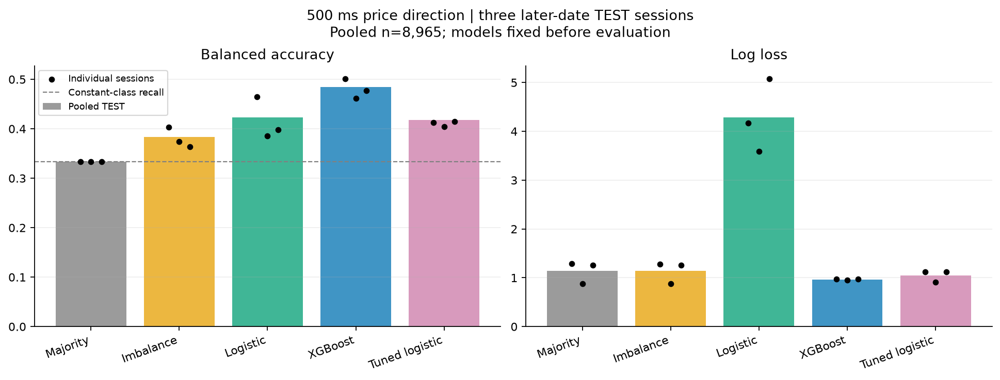

# Forward results after tuning

The development search compared 40 configurations across three purged expanding
folds. It selected class-weighted logistic regression with C=0.01 and 93 features,
excluding six absolute price levels. Mean development balanced accuracy was 45.71%,
versus 41.70% for the original XGBoost configuration. The full grid and scores are in
the [numerical record](tuning_experiment.json); [Methods](tuning.md) describes selection.

The forward check uses three new five-minute sessions recorded on October 29.
Training and validation remain on October 22, and the old TEST session is excluded.
TRAIN row fingerprints, imputation means, and scales match the original dataset
exactly. The selected configuration and four fixed baselines were frozen before
opening the new outcomes. No further tuning was done after this evaluation.

## Primary result: 500 ms

All models share 8,965 TEST targets: 2,206 DOWN, 4,796 STABLE, and 1,963 UP.

| Model | Accuracy | Balanced accuracy | Log loss |
| --- | ---: | ---: | ---: |
| Majority | 0.5350 | 0.3333 | 1.1454 |
| Imbalance sign | 0.2698 | 0.3832 | 1.1399 |
| Original logistic | 0.5632 | 0.4229 | 4.2808 |
| Original XGBoost | 0.5270 | 0.4842 | 0.9669 |
| Tuned logistic | 0.3590 | 0.4179 | 1.0482 |

The tuning did not improve the primary benchmark. Its development advantage over
XGBoost reversed on the later date: 41.79% versus 48.42% balanced accuracy.
The original tree remains the stronger model in this comparison.

The selected logistic variant has much better log loss than the original logistic
model (4.2808 to 1.0482, a 75.5% reduction), but slightly lower balanced accuracy.
XGBoost still has better log loss than both. The lower probability loss comes with
weaker classification, so this is not an overall win for the tuned model.

Absolute prices shifted substantially: TRAIN midprices range from $81,312.075 to
$81,438.13, while TEST ranges from $78,804.405 to $79,176.42. Removing price levels,
increasing regularization, and correcting class-cost probabilities together improved
the logistic model's probability estimates. This experiment does not isolate which
change caused the improvement.

Bars show pooled scores; dots show the individual sessions, not confidence intervals.

## Session consistency

Balanced accuracy at 500 ms:

| Session | Targets | Imbalance | Original logistic | Original XGBoost | Tuned logistic |
| --- | ---: | ---: | ---: | ---: | ---: |
| 1 | 2,988 | 0.4033 | 0.4643 | 0.5016 | 0.4130 |
| 2 | 2,989 | 0.3736 | 0.3860 | 0.4619 | 0.4040 |
| 3 | 2,988 | 0.3639 | 0.3982 | 0.4769 | 0.4146 |

XGBoost exceeds the imbalance baseline in all three sessions. Pooled balanced
accuracy is 10.10 percentage points higher (48.42% versus 38.32%). This supports a
specific comparison on these recordings, not a claim about long-run trading performance.

## Secondary horizons

The 500 ms configuration was reused without another search. Values are balanced accuracy.

| Model | 100 ms | 1 second | 5 seconds |
| --- | ---: | ---: | ---: |
| Majority | 0.3333 | 0.3333 | 0.3333 |
| Imbalance | 0.3932 | 0.3635 | 0.3656 |
| Original logistic | 0.4011 | 0.4093 | 0.3779 |
| Original XGBoost | 0.5375 | 0.4457 | 0.3776 |
| Tuned logistic | 0.4981 | 0.4029 | 0.3347 |

XGBoost is stronger at 100 ms and 1 second; neither learned variant clearly beats
the simple baselines at 5 seconds. The full numerical record includes accuracy,
per-class metrics, probability calibration, and class counts at each horizon.

## Checks and interpretation

All 438 tests, Ruff checks, and the wheel build pass. An independent audit checked
178,610 saved prediction rows across the 20 forward runs against labels, confusion
counts, log loss, confidence diagnostics, and hashes. Model source remained unchanged
through TEST evaluation.

These are still only 15 minutes from one date, with overlapping targets. The
ten-session bootstrap is unavailable, and no statistical significance or profitability
claim is made. Any further model changes need another untouched holdout.
